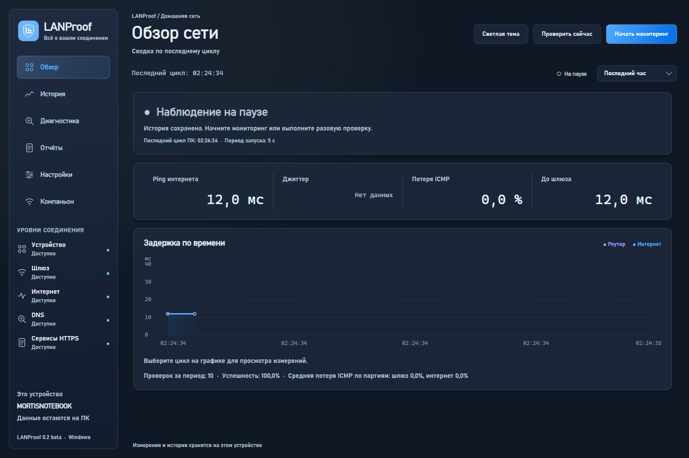
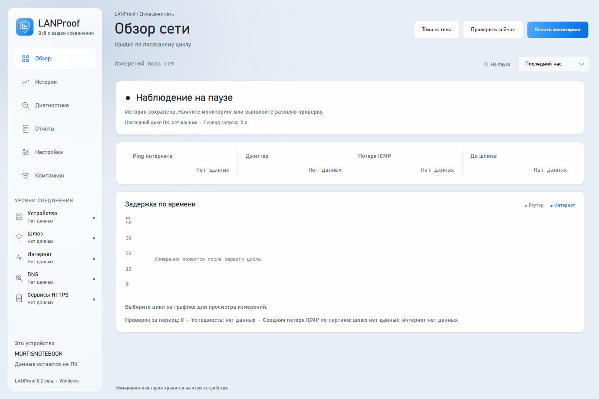
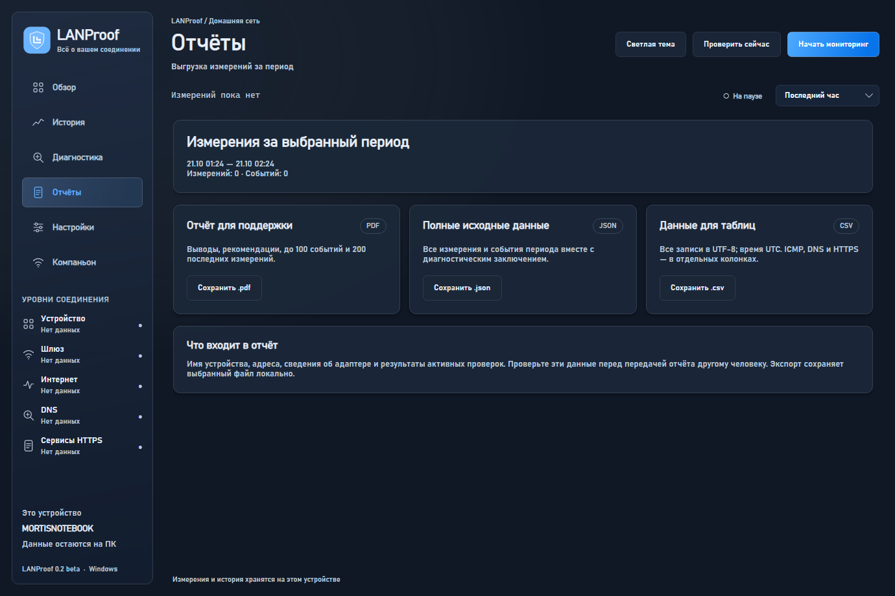

<p align="center"></p>

<h1 align="center">LANProof</h1>

<p align="center"><strong>Пойми, где пропадает интернет.</strong><br>Локальная диагностика домашней сети для Windows.</p>

<p align="center">
  <a href="https://github.com/MortisBTD/LANProof/releases"></a>
  
  
  <a href="LICENSE"></a>
</p>

<p align="center">
  <a href="https://github.com/MortisBTD/LANProof/releases">Скачать</a> ·
  <a href="#что-работает">Возможности</a> ·
  <a href="docs/DIAGNOSTICS.md">Как устроена диагностика</a> ·
  <a href="CONTRIBUTING.md">Участие в разработке</a> ·
  <a href="https://github.com/MortisBTD/LANProof/issues/new/choose">Сообщить об ошибке</a>
</p>



> **Windows MVP · версия 0.1.** На главном скриншоте — синтетические измерения из UI-теста. Диагностические выводы являются гипотезами, а не доказательством вины провайдера или оборудования.

Когда связь пропадает на несколько секунд, одного теста скорости мало. LANProof сохраняет измерения во времени и сопоставляет состояние устройства, шлюза, внешних IP, DNS и HTTPS. Историю можно изучить самому или передать в поддержку в виде отчёта.

```text
Устройство → Шлюз → Интернет → DNS → Сервисы HTTPS
```

**Без аккаунта и облака.** Измерения остаются на ПК; содержимое пользовательского трафика не перехватывается.

Приборный интерфейс: плотные поверхности, тонкие границы, моноширинные числа и пять уровней соединения в сайдбаре. По умолчанию включена **тёмная тема**. Кнопка «Светлая тема» переключает оформление без перезапуска; выбор сохраняется. Логотип, PNG, SVG-иконки и Windows ICO находятся в `assets/`.

<details>
<summary><strong>Светлая тема и экран отчётов</strong></summary>

Светлая тема, состояние без истории:



Экспорт измерений:



</details>

## Запуск

1. Скачайте ZIP для Windows x64 из [Releases](https://github.com/MortisBTD/LANProof/releases).
2. Распакуйте **всю** папку в доступное для записи место.
3. Запустите `LANProof.exe`.

Установка .NET и права администратора для готовой сборки не требуются. Мониторинг начинается при открытии окна; при закрытии останавливается. Для разовой проверки сначала остановите мониторинг, затем нажмите **«Проверить сейчас»**. После локальной публикации сборка лежит в `publish/LANProof-Windows-0.1`; её также запускает `Запустить LANProof.cmd` в корне проекта.

Для запуска из исходников нужен .NET SDK 8 или 9:

```powershell
git clone https://github.com/MortisBTD/LANProof.git
cd LANProof
dotnet restore LANProof.sln
dotnet run --project src/LANProof.App
```

## Что работает

- Параллельные проверки адаптера, шлюза ICMP, внешних IP ICMP, системного DNS и сервисов HTTPS.
- Задержка, джиттер внутри каждого IP, доля неудачных ping, опциональная оценка сигнала Wi-Fi.
- История SQLite, график за 15 минут / час / сутки / неделю, выбор отдельного цикла и детали измерений.
- Обнаружение потери связи, частичных потерь, высокой задержки, джиттера и слабого сигнала; объединение повторяющихся событий и фиксация завершения.
- Диагностика по сочетанию проверок одного устройства в одном цикле. Предположения о локальной сети, выходе в интернет, DNS, сервисе и ограничении ICMP.
- JSON и CSV со всеми данными выбранного периода; PDF с выводом, сводкой, последними 100 событиями и 200 измерениями.
- Проверка и сохранение пользовательских IP, доменов, HTTPS-адресов, таймаутов и интервала.

Пример: шлюз доступен, внешние IP и HTTPS одновременно не отвечают → вероятная проблема на выходе в интернет. Если HTTPS работает при отсутствии ICMP, приложение отдельно поясняет возможную фильтрацию ping.

## Данные и ограничения

Исходники находятся в `src/`, проверки — `tests/`, изображения — `assets/`, локальная сборка и ZIP — `publish/`, рабочие материалы — `work/`, инструменты — `tools/`. База `lanproof.db`, настройки `settings.json` и выбор темы `appearance.json` хранятся в **`data/` в корне проекта**. Если запустить отдельно распакованный архив вне проекта, папка `data/` создаётся рядом с exe. База, личные настройки и рабочие файлы исключены из Git. История старше 30 дней удаляется при запуске. В отчёт входят имя ПК, адреса и сведения об адаптере — проверяйте содержимое перед передачей другим людям.

Интервал в настройках — период запуска от начала одного цикла до начала следующего. Циклы не пересекаются. По умолчанию: период 5 с, предел цикла 4500 мс, один ping 800 мс, DNS/HTTPS 3000 мс. Разные внешние IP проверяются параллельно. Результат, не полученный до общего предела, помечается неопределённым: он не доказывает отказ или восстановление. Короткие обрывы между циклами могут остаться незамеченными. Все метки внутри базы и экспортов — UTC, интерфейс показывает локальное время Windows.

Успешность завершённых проверок и потери ICMP показываются отдельно. Неопределённые результаты исключены из успешности. Потери шлюза и внешних IP рассчитаны как среднее процентов потерь по партиям ping; успешные DNS/HTTPS не уменьшают эти значения. Достоверность гипотезы является эвристикой, не статистической вероятностью. Одиночный неудачный ping не доказывает вину роутера или провайдера. Джиттер — среднее абсолютное изменение соседних успешных ответов одного IP; при числе ответов меньше двух он неизвестен.

При открытии периода история читается потоком, затем обновляется по новым ID. Статистика учитывает все измерения периода; для графика хранится ограниченная выборка с экстремумами и отказами. Выбор цикла загружает его исходные результаты. JSON/CSV выгружают весь период потоком, PDF содержит сводку и ограниченные таблицы. Существующая база обновляется с сохранением измерений; пустая устаревшая таблица DiagnosticReports удаляется, непустая сохраняется.

DNS использует системный резолвер: измерение может обслуживаться кешем. Внешние IP и HTTPS-цели задаются отдельно. HTTPS считает успешными ответы 2xx: запрос HEAD, при 405/501 — GET с Range bytes=0-0 в пределах того же таймаута. Сервер может проигнорировать Range; приложение измеряет только время до заголовков, не загружает тело целиком. Пул соединений сохраняется между циклами. Это время ответа сервиса, включая DNS/TCP/TLS при холодном соединении, а не ICMP RTT. Прокси, VPN, антивирус и несколько активных адаптеров могут влиять на результаты; MVP выбирает первый активный Ethernet/Wi-Fi адаптер с IPv4-шлюзом, а не анализирует таблицу маршрутизации. Сигнал Wi-Fi читается через `netsh` для английского/русского вывода; Windows может не предоставлять его. Оценка dBm приблизительная.

Остановка и аварийное завершение наблюдения не считаются подтверждённым восстановлением связи. После остановки событие заканчивается временем последнего измерения с соответствующей пометкой.

Приложение выполняет активные сетевые проверки и не перехватывает пользовательский трафик. Аккаунта, аналитики и отправки измерений в облако нет. Самостоятельный экспорт сохраняет выбранный файл локально.

## Следующие этапы концепции

Android-компаньон, защищённое сопряжение, офлайн-очередь телефона и межустройственная корреляция пока **не реализованы**. Также не входят в 0.1: фоновая служба/трей, Wi-Fi-анализатор каналов, тест bufferbloat, Game Mode, автоматические уведомления, карта сети. Текущий анализ ограничен Windows-ПК. Полная концепция — в `docs/CONCEPT.md`.

## Структура

| Модуль | Назначение |
| --- | --- |
| Core | Модели, контракты, детектор событий, правила диагностики |
| Probes | Сетевые проверки и планировщик с защитой от пересечения циклов |
| Data | SQLite / EF Core, репозитории и UTC-преобразования |
| Runtime | Мониторинг, жизненный цикл, настройки и атомарное сохранение |
| Export | JSON, CSV и PDF |
| App | Windows-интерфейс Avalonia и интерактивный график |
| Tests | Проверки диагностики, сбоев, таймаутов, хранения, экспорта и перезапуска |

## Проверка и сборка

```powershell
dotnet test LANProof.sln -c Release
dotnet build LANProof.sln -c Release
dotnet publish src/LANProof.App -c Release -r win-x64 --self-contained true -o publish/LANProof-Windows-0.1
```

Перегенерация кадров и локального замера истории:

```powershell
$env:LANPROOF_UI_QA_DIR="$PWD\work\ui-preview"
$env:LANPROOF_BENCHMARK_DIR="$PWD\work\benchmarks"
dotnet test LANProof.sln -c Release
```

Кадры `dark-0`…`dark-4` и `light-0`…`light-4` показывают все страницы без истории; `dark-overview-synthetic.png` — заполненные метрики на тестовых данных. Для упаковки опубликованной сборки используется `python tools/package.py`.

Интеграционная проверка с реальной сетью и отдельной базой (процесс создаёт JSON, CSV, PDF и `result.txt`):

```powershell
Start-Process -FilePath .\publish\LANProof-Windows-0.1\LANProof.exe -ArgumentList '--smoke', "$PWD\work\network-smoke" -Wait
```

На локальной Windows-сборке проверено **49 тестов**. Синтетический прогон 604 800 измерений: начальное чтение **4,4 с**, обновление по пяти новым строкам — **7 мс**. Это результат одного локального прогона, не гарантия производительности. Статус автоматической проверки GitHub — в [Actions](https://github.com/MortisBTD/LANProof/actions).

## Участие и лицензия

Правила участия — в [CONTRIBUTING.md](CONTRIBUTING.md), история версий — в [CHANGELOG.md](CHANGELOG.md), сообщения об уязвимостях — в [SECURITY.md](SECURITY.md).

Код LANProof — [MIT License](LICENSE). Зависимости сохраняют собственные лицензии. Для QuestPDF применяется [Community License](https://www.questpdf.com/license/guide.html); сведения о компонентах и доступные тексты лицензий включены в архив приложения.
